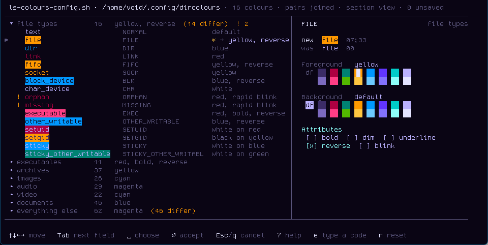
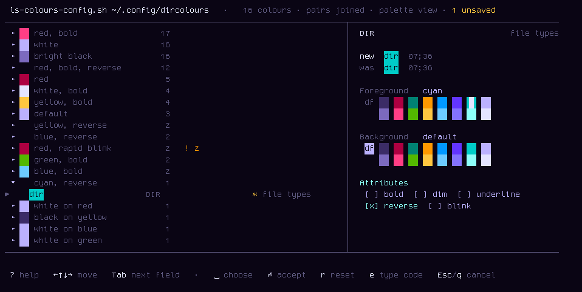

# ls-colours-config

My terminal tool for the file that decides the colours of `ls`: it previews, checks, repairs and edits a GNU `dircolors` configuration.
One bash script, no dependencies beyond bash and GNU coreutils.

## Browse by categories
<p align="center"></p>

## Browse by palette grouping
<p align="center"></p>

## Install
Copy the one file somewhere on your `PATH` and make it executable:

```sh
curl -fsSLo ~/.local/bin/ls-colours-config.sh https://raw.githubusercontent.com/VoidCrowned/ls-colours-config/main/ls-colours-config.sh
chmod +x ~/.local/bin/ls-colours-config.sh
```

## Usage
```sh
ls-colours-config.sh COMMAND [OPTIONS] [FILE]
```

| Command | |
|---|---|
| `preview` | list one sample per entry with the real `ls`, then run `check` |
| `check` | report problems in the file (exit status 1 when there are any) |
| `fix` | walk through the problems found by `check` and repair them |
| `edit` | change colours in a full-screen editor (`?` lists the keys) |
| `sample` | print the built-in sample config |
| `help` | show the help, or the help of a command: `help edit` |

Without `FILE` it takes the first that exists of `$XDG_CONFIG_HOME/dircolors`, `$XDG_CONFIG_HOME/.dir_colors`, `~/.dir_colors` and `~/.dircolors`, or offers to create one from the [sample](examples/dircolors.sample). `ls-colours-config.sh help COMMAND` lists the options.

## What it does to your file
Nothing without your confirmation: you see the diff first, a backup is made next to the file, and lines it does not change stay byte for byte as they are.

## Requirements
- bash 4.0 or newer
- GNU coreutils (`ls`, `dircolors`); `gls` / `gdircolors` and `gnuls` / `gnudircolors` work too

GNU only: the BSD `LSCOLORS` format is not supported, and macOS is untested.

## Tests
```sh
# add --json for a summary line to paste into an issue
tests/run.sh
```

## Licence
Copyright © 2026 VoidCrowned. This program is free software. It comes without any warranty, to the extent permitted by applicable law. You can redistribute it and/or modify it under the terms of the Do What The Fuck You Want To Public License, Version 2, as published by Sam Hocevar. See [LICENSE](LICENSE) or http://www.wtfpl.net/ for more details.
